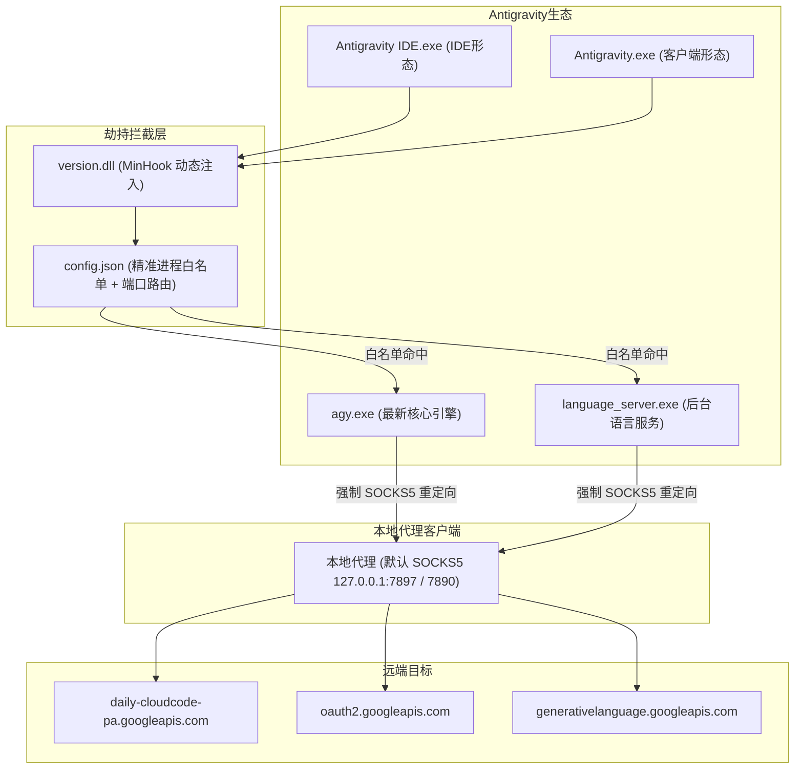

# 🚀 Antigravity Universal No-TUN Proxy Solution

[](https://github.com/anyvolunteer/antigravity-no-tun-proxy)
[](https://github.com/anyvolunteer/antigravity-no-tun-proxy)
[](https://github.com/anyvolunteer/antigravity-no-tun-proxy)
[](AI_INSTRUCTIONS.md)
[](LICENSE)

**Antigravity 全生态免 TUN 模式登录与核心 API 强制代理解决方案**  
为 **Antigravity IDE**、**Antigravity 桌面客户端** 以及 **AGY 命令行终端** 打造的透明进程级网络劫持套件。

在中国大陆网络环境下，**无需开启 TUN 虚拟网卡模式**，**无需购买或配置 Proxifier**，解决登录白屏、死循环及核心请求超时问题：
```text
Authentication Required: Post "https://daily-cloudcode-pa.googleapis.com/v1internal:loadCodeAssist": context deadline exceeded
```

---

## 📌 为什么需要本方案？

| 方案对比 | 全局 TUN 模式 | Proxifier 方案 | 本方案 (No-TUN DLL 劫持) |
| :--- | :--- | :--- | :--- |
| **系统侵入性** | 极高（接管全局网卡与路由表） | 中（安装驱动与内核网络过滤） | **极低（仅放置同级 DLL，绿色无感）** |
| **国内软件/游戏干扰** | 易导致微信卡顿、游戏断线或国内直连变慢 | 易与其他驱动冲突或误拦截 | **完全零干扰（仅精准拦截 Antigravity 白名单进程）** |
| **AGY 终端与新版引擎** | 依赖虚拟网卡全局捕获 | 需手动针对多个子进程编写规则 | **原生覆盖 `agy.exe`、`language_server.exe` 等全部进程** |
| **双端支持** | 支持 | 需分别配置规则 | **自动识别并同时支持 IDE 与 独立客户端** |
| **AI 自动化配置** | 困难（需 GUI 操作或高特权网卡） | 困难（需复杂配置文件生成） | **极高（提供 [AI 指导规范](AI_INSTRUCTIONS.md)，AI 助手可一键秒配）** |

---

## 🧠 工作原理与架构

基于 Windows PE 加载器的 **DLL 动态寻址机制（DLL Search-Order Hijacking）**：
在主程序同级目录下放置经过 MinHook 劫持包装的 `version.dll` 与 `config.json`。主程序启动加载系统 `version.dll` 时会优先加载当前目录版本，进而精准拦截子进程 Socket 通信，将目标域名请求转发至本地代理端口。



---

## ⚡ 快速开始 (Quick Start)

### 选项 A：人类用户 1 步安装

在 Windows PowerShell（无需管理员权限）中直接执行：

```powershell
# 克隆仓库并自动安装（默认自动检测本地代理端口，如 7897 / 7890）
git clone https://github.com/anyvolunteer/antigravity-no-tun-proxy.git
cd antigravity-no-tun-proxy
powershell -ExecutionPolicy Bypass -File deploy.ps1
```

> **自定义端口示例**：如果您的代理客户端运行在 `7890` 或 `10808` 端口：
> ```powershell
> powershell -ExecutionPolicy Bypass -File deploy.ps1 -Port 7890
> ```

安装完成后，**彻底关闭并重新启动** Antigravity 客户端或 IDE 即可！

---

### 选项 B：AI 助手自动化配置 (AI-Ready)

如果您正在使用任何 AI 编码助手（如 Antigravity 自身、Claude Code、Cursor、GitHub Copilot、OpenCode 等），只需将以下 Prompt 发送给它：

> **给 AI 的提示词 (复制即用)**：
> ```text
> 请阅读 https://raw.githubusercontent.com/anyvolunteer/antigravity-no-tun-proxy/main/AI_INSTRUCTIONS.md 
> 帮我将 Antigravity 免 TUN 代理套件部署到本机的 Antigravity IDE 和桌面客户端中。
> 请先自动检测我电脑上活跃的本地代理端口，然后完成部署与 SOCKS5 连通性测试。
> ```

---

## 🔍 状态诊断与验证

部署后，可随时运行内置诊断脚本验证生效状态：

```powershell
powershell -ExecutionPolicy Bypass -File verify.ps1
```

输出示例：
```text
================ Antigravity No-TUN Proxy Diagnostics ================

[1/3] Process Hook Status:
  - Antigravity IDE: [HOOK ACTIVE] Loaded: ...\Antigravity IDE\VERSION.dll
  - Antigravity Client: [HOOK ACTIVE] Loaded: ...\antigravity\VERSION.dll

[2/3] Configuration Files:
  - Antigravity IDE\config.json: Present (Port: 7897, Type: socks5)
  - antigravity\config.json: Present (Port: 7897, Type: socks5)

[3/3] SOCKS5 Connectivity (127.0.0.1:7897):
  - daily-cloudcode-pa.googleapis.com:443 -> [PASS] SOCKS5 connection ok
  - oauth2.googleapis.com:443 -> [PASS] SOCKS5 connection ok

================ Diagnostic Complete ================
```

---

## 🧩 为什么本仓库与旧方案不同？

以往的免 TUN 方案多仅针对单个老版本程序，在当前 Antigravity 2.0 大版本跃迁后容易失效。本仓库进行了多项关键强化：

1. **补齐新版 `agy.exe` 核心引擎**：
   新版 Antigravity 已将统一底层引擎替换为 `agy.exe`，原旧版配置因为白名单中缺失该项，会导致终端与对话依然因超时断开。本配置全量包含 `agy.exe`、`Antigravity IDE.exe`、`Antigravity.exe`、`language_server.exe` 与 `node.exe`。
2. **双轨架构全覆盖**：
   自动检测并同时保护 `%LOCALAPPDATA%\Programs\Antigravity IDE` 与 `%LOCALAPPDATA%\Programs\antigravity`，杜绝“IDE 能用但客户端报错”的隔离痛点。
3. **文件锁容错机制**：
   若程序正在运行且 `version.dll` 哈希一致，自动跳过覆盖，避免 Windows `0x20` 文件被占用报错。
4. **命令行环境指引**：
   若需在外部独立 PowerShell 中运行原生 `agy` 命令行，只需在外部窗口执行：
   ```powershell
   $env:ALL_PROXY = "socks5://127.0.0.1:7897"
   ```

---

## 🧯 故障排查 (Troubleshooting)

### 1. 报错 `User location is not supported for the API use`
* **原因**：这说明 **DLL 劫持与本地 SOCKS5 代理已经成功连通**！失败原因是当前代理节点的公网出口 IP 属于受限地区，或被 Google 标记为了数据中心机房 IP。
* **解决办法**：无需改动任何本地文件，只需在代理客户端中切换节点，建议选用住宅/普通 ISP 类型的支持地区节点（如美国、日本、新加坡、中国台湾等）。

### 2. 依然提示 `Authentication Required`
* 检查本地代理软件（Clash、Mihomo、v2rayN）是否正常开启，并核对端口是否与 `config.json` 一致。
* 若代理端口仅支持 HTTP 而不支持 SOCKS5，将 `config.json` 中的 `"type": "socks5"` 改为 `"type": "http"`。

---

## 📜 许可证与致谢

- 核心注入原理与底层技术基于 [yuaotian/antigravity-proxy](https://github.com/yuaotian/antigravity-proxy)，基于 BSD-2-Clause 协议开源。
- Hook 核心技术感谢 [Tsuda Kageyu / MinHook](https://github.com/TsudaKageyu/minhook)。
- 本项目针对 Antigravity 2.0 统一架构（IDE、Client、AGY CLI 三端）进行维护、扩展配置与自动化工程化封装。
